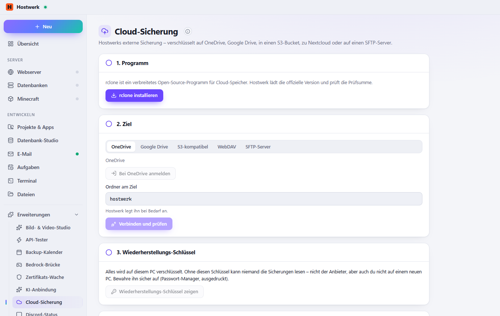

# Cloud-Sicherung

Hostwerks externe Sicherung zusätzlich in die Cloud: OneDrive, Google Drive, S3 (AWS, Cloudflare R2, Backblaze …), Nextcloud/WebDAV oder SFTP – auf diesem PC verschlüsselt, mit Wiederherstellungs-Schlüssel und derselben Wiederherstellungs-Probe.

[English](README.md) · Eine offizielle [Hostwerk](https://github.com/Passimoritz/hostwerk-public) Erweiterung (SDK 2.7, native Erweiterung)



## Was sie kann

- Fügt Hostwerks externer Sicherung das Ziel „Cloud (verschlüsselt)“ hinzu – Zeitplan, Aufbewahrung, Alarme und Wiederherstellungs-Probe bleiben, wie sie sind
- OneDrive und Google Drive (Anmeldung im Browser), S3-kompatibler Speicher, Nextcloud/WebDAV, SFTP
- Auf diesem PC verschlüsselt mit rclone crypt (auch die Namen) – der Anbieter sieht nie den Inhalt; Wiederherstellungs-Schlüssel zum sicheren Aufbewahren
- Verbindungs-Test: schreiben, zurücklesen, entschlüsseln
- rclone kommt von der offiziellen Seite, mit Prüfsummen-Kontrolle

## Neu in 1.1

- Wiederherstellungs-Schlüssel eines anderen PCs eingeben – nach einem Umzug sind ältere Sicherungen wieder lesbar
- Geheimnisse (S3-Schlüssel, Passwörter, Verschlüsselungs-Passwort) nie in rclone.conf oder der Prozessliste
- OneDrive Business und SharePoint, Anmeldung auf einem anderen PC für Server ohne Bildschirm
- Sicherungen am Ziel und die letzten Läufe auf der Seite, freier Platz, Bandbreitengrenze mit Zeitfenster
- Läufe (auch fehlgeschlagene) im Sicherungs-Kalender (Dienst `cloudBackup`)

## Installieren

In Hostwerk: **Erweiterungen → Entdecken** und „Installieren“ klicken.

Native Erweiterungen laufen als Teil von Hostwerk (eigener Server- und Oberflächen-Teil). Deshalb installiert Hostwerk sie nur aus dem offiziellen Katalog (mit Prüfsumme) oder im Entwickler-Modus.

## Daten

`data/cloud-backup` – rclone-Einstellungen und der verschlüsselte Schlüssel (Geheimnisse mit Hostwerks Schlüssel versiegelt). Das Programm liegt in `bin/rclone`. Beim Entfernen der Erweiterung bleibt beides; die Sicherungen am Ziel bleiben immer.

## Entwickeln

```bash
node --test tests/*.test.js          # Tests
node build-native.js .               # Oberfläche bauen (sdk/build-native.js aus hostwerk-public)
node check.js . --strict             # dieselbe Prüfung wie der Katalog (sdk/check.js)
```

Oberfläche in `ui/src`, Server-Teil in `server/`. Texte im Code sind Englisch, Deutsch steht in `locales/de.json`.

## Lizenz

MIT
