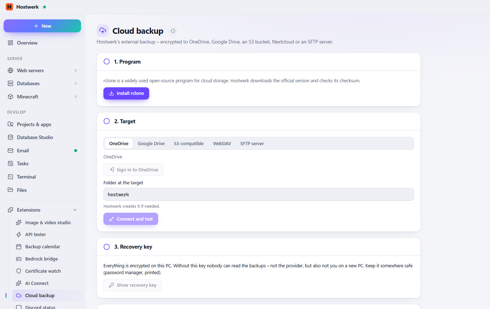

# Cloud backup

Hostwerk's external backup to the cloud too: OneDrive, Google Drive, S3 (AWS, Cloudflare R2, Backblaze …), Nextcloud/WebDAV or SFTP – encrypted on this PC, with a recovery key and the same restore probe.

[Deutsch](README.de.md) · An official [Hostwerk](https://github.com/Passimoritz/hostwerk-public) extension (SDK 2.7, native extension)



## What it does

- Adds the target “Cloud (encrypted)” to Hostwerk's external backup – schedule, retention, alerts and restore probe stay as they are
- OneDrive and Google Drive (sign-in in the browser), S3-compatible storage, Nextcloud/WebDAV, SFTP
- Encrypted on this PC with rclone crypt (names too) – the provider never sees the content; recovery key to keep safe
- Connection test: write, read back, decrypt
- rclone is downloaded from the official site with checksum check

## New in 1.1

- Enter the recovery key of another PC – after a move, older backups can be read again
- Secrets (S3 keys, passwords, encryption password) never in rclone.conf or the process list
- OneDrive Business and SharePoint, sign-in on another PC for servers without a screen
- Backups at the target and the last runs on the page, free space, bandwidth limit with time window
- Runs (also failed ones) in the backup calendar (service `cloudBackup`)

## Install

In Hostwerk: **Extensions → Discover** and click “Install”.

Native extensions run as part of Hostwerk (own server and interface part). That is why Hostwerk only installs them from the official catalogue (with checksum) or in developer mode.

## Data

`data/cloud-backup` – rclone configuration and the encrypted key (secrets sealed with Hostwerk's key). The program is in `bin/rclone`. Removing the extension keeps both; the backups at the target always stay.

## Develop

```bash
node --test tests/*.test.js          # tests
node build-native.js .               # build the interface (sdk/build-native.js from hostwerk-public)
node check.js . --strict             # same check as the catalogue (sdk/check.js)
```

Interface source in `ui/src`, server part in `server/`. Texts in the code are English, German is in `locales/de.json`.

## License

MIT
